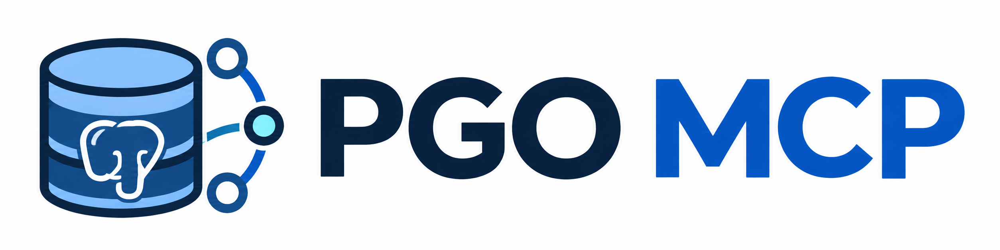

# pgo-mcp
pgo-mcp


# checking
```bash
npx @modelcontextprotocol/inspector --cli \
  http://127.0.0.1:8001/mcp \
  --transport http \
  --method tools/list
```

# tool calling
## calling to list schemas
```bash
npx @modelcontextprotocol/inspector --cli \
  http://127.0.0.1:8001/mcp \
  --transport http \
  --method tools/call \
  --tool-name list_schemas
```

## calling to list_objects
``` bash
npx @modelcontextprotocol/inspector --cli \
  http://127.0.0.1:8001/mcp \
  --transport http \
  --method tools/call \
  --tool-name list_objects \
  --tool-arg schema_name=public \
  --tool-arg object_type=table
```
**tool args list:**
  - table
  - view
  - sequence
  - extension

unsupported object type error test:
```bash
  npx @modelcontextprotocol/inspector --cli \
  http://127.0.0.1:8001/mcp \
  --transport http \
  --method tools/call \
  --tool-name list_objects \
  --tool-arg schema_name=public \
  --tool-arg object_type=invalid
```

## calling to get_object_details
```bash
npx @modelcontextprotocol/inspector --cli \
  http://127.0.0.1:8001/mcp \
  --transport http \
  --method tools/call \
  --tool-name get_object_details \
  --tool-arg schema_name=public \
  --tool-arg object_name=procurements \
  --tool-arg object_type=table
```